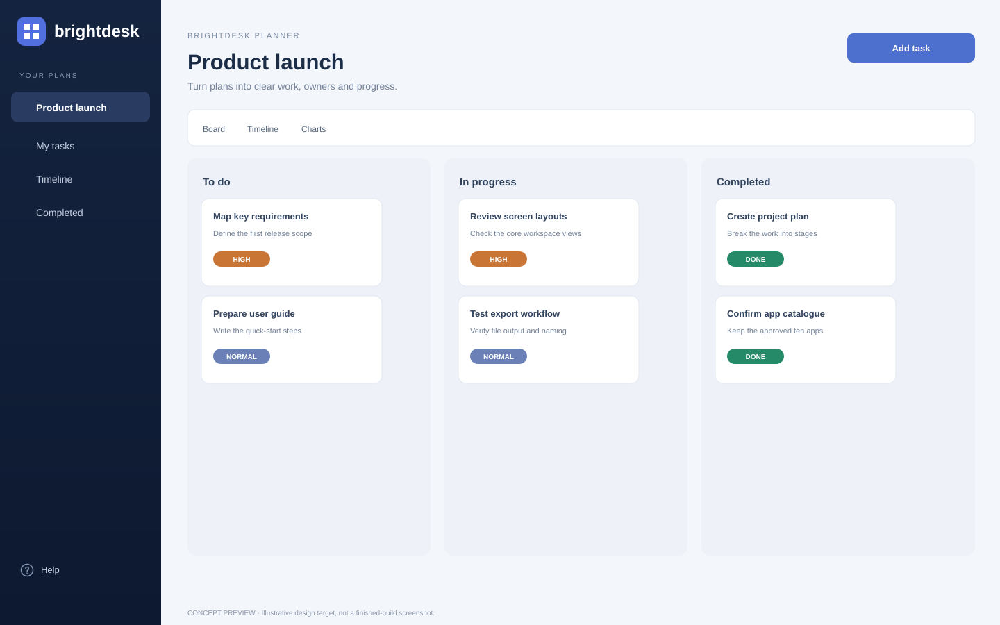

# Brightdesk Planner

 <strong>brightdesk</strong>

<strong>Plan projects, organise tasks and track progress.</strong>

Select the preview to open the full-size artwork.

> **Concept artwork — not a screenshot.** The preview above is original Brightdesk design artwork, not a capture from the running desktop build. A genuine screenshot will be added only after the current product window has been launched and its primary workflow checked.

## Desktop implementation

This repository contains the desktop source for Brightdesk Planner. Electron hosts the desktop interface, the product module is maintained in `src/planner-workspace.js`, and the professional visual system is loaded from `src/design-system.css`. The preview above is concept artwork rather than a captured product screenshot.

- [Desktop interface](src/index.html)
- [Brightdesk Planner feature module](src/planner-workspace.js)
- [Brightdesk visual system](src/design-system.css)
- [Interface integration tests](tests/planner-ui-integration.test.js)
- [Shared Brightdesk Suite](https://github.com/connormolloy12/Brightdesk-suite)

## Shared Brightdesk design standard

The product follows the [Brightdesk visual and interaction standard](https://github.com/connormolloy12/Brightdesk-suite/blob/main/docs/BRIGHTDESK_VISUAL_STANDARD.md) for branding, icon usage, layout, responsive behaviour and accessibility.

## Current first-use workflows

- Create and rename plans.
- Create, rename and delete buckets; retain tasks when a bucket is removed by moving them to a remaining bucket.
- Create, edit, move, filter and delete tasks.
- Track task descriptions, priority, progress, due date, assignee text and labels.
- Search and filter tasks by progress, priority and other supported task fields.
- Save plans locally on this device.

**Not included in this first version:** Connected user directories, automatic assignment, operating-system notifications, recurring reminders, cloud sync and shared plans.

## Implementation status

**Desktop source is committed to `main`.** This repository includes an Electron desktop shell, product modules, the shared visual system, Rust engine integration, build scripts and automated interface tests. The concept preview is not a screenshot from a running build. A platform desktop installer should only be described as ready after its build and verification checks pass.

## Design brief

See [docs/DESIGN_BRIEF.md](docs/DESIGN_BRIEF.md) for the screen designs, navigation and acceptance targets.

## Related project

[Brightdesk Office Suite](https://github.com/connormolloy12/Brightdesk-suite)
